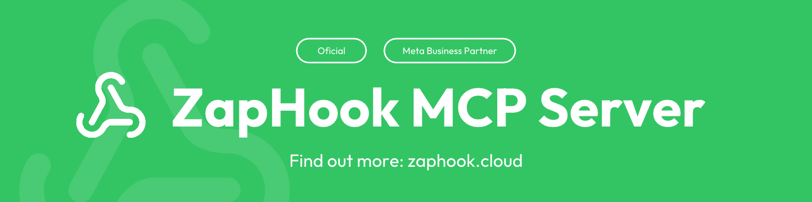

<div align="center">

[](https://zaphook.cloud)

# ZapHook MCP Server

**Connect Claude, Cursor and other AI assistants to WhatsApp Business through [ZapHook](https://zaphook.cloud).**
Read conversations, send messages and templates, manage channels and webhooks, and debug delivery, in plain language.

[](LICENSE)
[](https://modelcontextprotocol.io)
[](#quick-start)

**English** · [Português](README.pt-BR.md)

</div>

---

## What it is

The ZapHook MCP Server is a **hosted** [Model Context Protocol](https://modelcontextprotocol.io) server. You add one URL and your ZapHook API key to your AI client, and the assistant can work with your WhatsApp Business account:

- "Which conversations are waiting for a reply today?"
- "Read the last conversation with +55 11 99999-8888 and draft an answer."
- "Send our approved `welcome` template to this customer."
- "Why did messages fail to reach my webhook yesterday?"

There is nothing to install or run. The server works with **standard** and **coexistence** (WhatsApp Business app + API) channels.

This repository holds the documentation, client examples and the registry manifest. The server itself runs on ZapHook's infrastructure.

## Quick start

| | |
|---|---|
| **Server URL** | `https://api.zaphook.cloud/mcp` |
| **Transport** | Streamable HTTP |
| **Authentication** | `Authorization: Bearer YOUR_API_KEY` header (or `X-API-Key: YOUR_API_KEY`) |

1. **Create a ZapHook account** at [zaphook.cloud](https://zaphook.cloud/login) and connect at least one WhatsApp channel.
2. **Create an API key** in the dashboard: *Settings → API Keys → Create API key* ([step-by-step with screenshots](docs/authentication.md)).
3. **Add the server to your client** using one of the setups below.

### Claude (claude.ai and Claude Desktop)

1. Open **Settings → Connectors → Add custom connector**.
2. **Name:** `ZapHook` · **Remote MCP server URL:** `https://api.zaphook.cloud/mcp`
3. **Authentication:** choose **No login** (the API key goes in a header, not OAuth).
4. **Request headers → Add header:** name `Authorization`, value `Bearer YOUR_API_KEY`.
5. Save, start a new chat and ask: *"List my ZapHook channels."*

Details: [examples/claude-ai.md](examples/claude-ai.md).

### Claude Code

```bash
claude mcp add --transport http zaphook https://api.zaphook.cloud/mcp \
  --scope user --header "Authorization: Bearer YOUR_API_KEY"
```

Windows PowerShell and other details: [examples/claude-code.md](examples/claude-code.md).

### Cursor

`~/.cursor/mcp.json` (or `.cursor/mcp.json` in a project):

```json
{
  "mcpServers": {
    "zaphook": {
      "url": "https://api.zaphook.cloud/mcp",
      "headers": { "Authorization": "Bearer YOUR_API_KEY" }
    }
  }
}
```

### More clients

| Client | Example |
|---|---|
| VS Code (GitHub Copilot) | [examples/vscode.json](examples/vscode.json) |
| Kiro | [examples/kiro.json](examples/kiro.json) |
| Clients that only support stdio (via `mcp-remote`) | [examples/mcp-remote.json](examples/mcp-remote.json) |

> **Never commit a real API key.** Keep it in your client's secret storage or an environment variable. If a key leaks, revoke it in the dashboard and create a new one.

## Tools

31 tools, grouped by area. **📤 sends a real WhatsApp message** (cannot be undone). **🗑️ deletes data permanently.** Full reference with parameters: [docs/tools.md](docs/tools.md).

### Inbox (read-only)

| Tool | What it does |
|---|---|
| `zaphook_list_conversations` | Lists conversations, newest first, with contact, unread count, a short preview of the last message and whether the 24-hour window is open. Filters: channel, status, unread, search by phone or name, dates. |
| `zaphook_get_conversation` | One conversation, including the 24-hour window status. |
| `zaphook_list_conversation_messages` | Full message history (incoming and outgoing) of a conversation, paginated. |

### Messages

| Tool | What it does |
|---|---|
| `zaphook_send_text` 📤 | Text message. |
| `zaphook_send_template` 📤 | Approved template. Required to start a conversation or write outside the 24-hour window. |
| `zaphook_send_image` 📤 | Image (public HTTPS link or media ID). |
| `zaphook_send_video` 📤 | Video. |
| `zaphook_send_audio` 📤 | Audio. |
| `zaphook_send_document` 📤 | Document (PDF, spreadsheet, etc.). |
| `zaphook_send_sticker` 📤 | Sticker (.webp). |
| `zaphook_send_location` 📤 | Location pin. |
| `zaphook_request_location` 📤 | Asks the contact to share their location. |
| `zaphook_send_contact` 📤 | Contact card(s). |
| `zaphook_send_buttons` 📤 | Up to 3 quick-reply buttons. |
| `zaphook_send_list` 📤 | Interactive list menu. |
| `zaphook_send_reaction` 📤 | Emoji reaction to a message. |
| `zaphook_mark_as_read` | Marks a received message as read (blue ticks). Sends no content. |
| `zaphook_send_typing` | Shows "typing…" to the contact for about 25 seconds and marks the message as read. Sends no content. |

### Channels and templates

| Tool | What it does |
|---|---|
| `zaphook_list_channels` | Lists your WhatsApp channels (standard and coexistence). Start here. |
| `zaphook_get_channel` | One channel by ID. |
| `zaphook_get_channel_health` | Live number health from Meta: connection, quality rating, messaging limit tier, verified name. |
| `zaphook_list_channel_templates` | Message templates with approval status, rejection reason and variables. |
| `zaphook_create_channel` | Creates a standard channel with an auto-generated webhook URL. |
| `zaphook_update_channel` | Renames, pauses/activates or changes the webhook secret of a standard channel. |
| `zaphook_delete_channel` 🗑️ | Permanently deletes a standard channel with its destinations and event logs. |

### Destinations (webhooks)

| Tool | What it does |
|---|---|
| `zaphook_list_destinations` | URLs that receive a channel's events. Header and auth values are masked. |
| `zaphook_create_destination` | Adds a destination to a standard channel. |
| `zaphook_update_destination` | Updates, pauses or activates a destination. |
| `zaphook_delete_destination` 🗑️ | Removes a destination. |

### Events (delivery debugging)

| Tool | What it does |
|---|---|
| `zaphook_list_events` | Received and delivered events, filterable by channel, type, delivery status, errors and dates. |
| `zaphook_get_event` | One event in detail: original and processed payload, destination response, attempts and errors. |

## Example prompts

- "Which conversations on my Support channel are unread? Summarize what each customer wants."
- "Is the 24-hour window still open with this contact? If not, which template should I use?"
- "Reply to Maria: *Your order has shipped and arrives tomorrow.*"
- "Show the events that failed in the last 24 hours and explain the errors."
- "Check the health of all my numbers."

More: [examples/prompts.md](examples/prompts.md).

## Safety by design

- **Confirmation before sending.** Every sending tool tells the assistant to show you the recipient and the exact content and wait for your confirmation. Most clients also ask before running a tool. Review each confirmation: a sent message cannot be recalled.
- **No automatic retries on sends.** If a send times out, the assistant is told to check the events before trying again, so the same message is not sent twice.
- **Incoming content is data, not instructions.** Messages from contacts are marked as third-party content, so an assistant should never follow instructions written inside a customer message.
- **Secrets stay masked.** Webhook secrets, tokens and destination credentials come back as `***`. The server never asks for your Meta access token.
- **Your key, your account.** Each request uses only the API key in that request. Nothing is shared between users.
- **HTTPS only**, with rate limits per key.

## WhatsApp rules worth knowing

| Situation | What to do |
|---|---|
| The contact has not written in the last 24 hours | Meta only allows free-form messages inside the 24-hour customer service window. Use `zaphook_send_template` with an approved template. |
| Sending media | Use a public HTTPS link that opens the file directly, or a media ID. Files on your computer cannot be sent directly; see [Troubleshooting](docs/troubleshooting.md#sending-media). |
| Phone number format | Country code plus number, digits only. Example: `5511999998888`. |
| A send timed out | Check `zaphook_list_events` before retrying. |
| Template not found | List templates and use the exact `name` and `language`. |

You are responsible for following the [WhatsApp Business Messaging Policy](https://business.whatsapp.com/policy), including collecting opt-in before messaging contacts. More answers: [docs/troubleshooting.md](docs/troubleshooting.md).

## Requirements

- A [ZapHook](https://zaphook.cloud) account with at least one WhatsApp channel.
- A ZapHook API key.
- An MCP client that supports Streamable HTTP with custom headers, or the `mcp-remote` bridge.

## Related

- [ZapHook](https://zaphook.cloud): website and dashboard.
- [ZapHook documentation](https://zaphook.gitbook.io/docs): public REST API.
- [ZapHook Agent Skills](https://github.com/zaphook/zaphook-agent-skills): the same capabilities as skills for Claude Code, Kiro, Gemini CLI and Codex CLI.

## Support and contributing

- Bugs and feature requests: [GitHub Issues](https://github.com/zaphook/zaphook-mcp-server/issues).
- Security issues: see [SECURITY.md](SECURITY.md). Please do not open public issues for vulnerabilities.
- Documentation and example improvements are welcome: [CONTRIBUTING.md](CONTRIBUTING.md).

## License

Documentation and examples in this repository are licensed under the [MIT License](LICENSE).

This MCP server is provided and operated by ZapHook, not by Meta. WhatsApp and Meta are trademarks of Meta Platforms, Inc.
