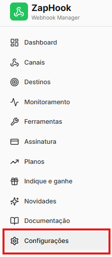
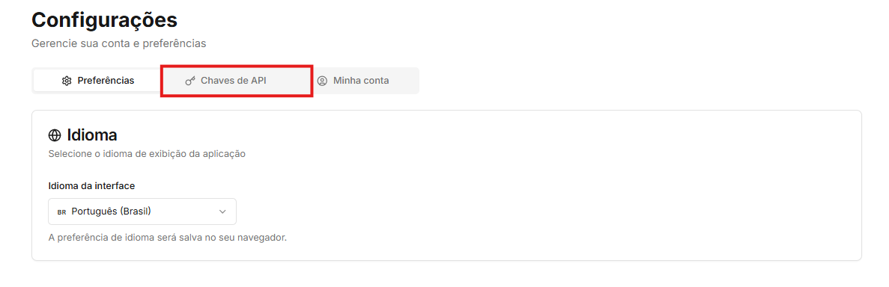
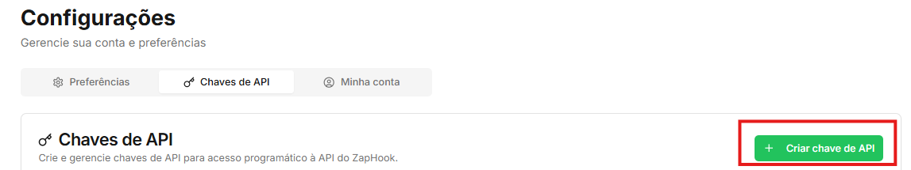
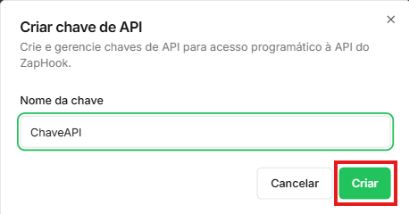
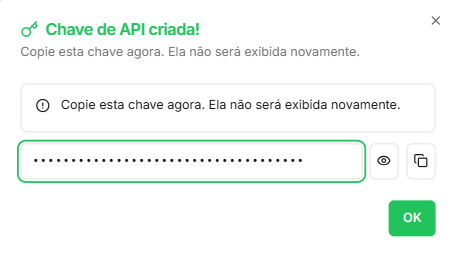

# Authentication

The ZapHook MCP Server uses your **ZapHook API key**. Each request carries the key in a header, and the server acts on the account that owns that key. There is no OAuth login.

## Create an API key

1. Open the [ZapHook dashboard](https://zaphook.cloud/dashboard) and go to **Settings**.

   

2. Open the **API Keys** tab.

   

3. Click **Create API key**.

   

4. Give the key a name (for example `Claude` or `Cursor`) and click **Create**.

   

5. Copy the key and store it somewhere safe. Do not share it.

   

Use one key per client or per person. That way you can revoke one without breaking the others.

## Send the key

Use one of these headers on every request:

| Header | Value |
|---|---|
| `Authorization` (recommended) | `Bearer YOUR_API_KEY` |
| `X-API-Key` | `YOUR_API_KEY` |

If both are present, `Authorization` wins. The key is never accepted in the URL: a URL with query parameters is rejected, so the key does not end up in logs or browser history.

## What the key can do

The key has the same reach as the ZapHook public API for your account: it can read your channels, conversations and events, change channels and destinations, and send WhatsApp messages. Treat it like a password.

## Rotate or revoke a key

- **Rotate** regularly: create a new key, update your clients, then delete the old one.
- **Revoke immediately** if a key appears in a screenshot, a chat, a commit or a log. Delete it in **Settings → API Keys** and create a new one.

## Common errors

| Response | Meaning | Fix |
|---|---|---|
| HTTP 401 when connecting | The key is missing or the header is malformed. | Check that the value is exactly `Bearer YOUR_API_KEY`, with one space and no quotes. |
| Tool result "API key inválida, ausente ou revogada" | The key was revoked or is wrong. | Create a new key and update your client. |
| HTTP 400 with `MCP_QUERY_NOT_ALLOWED` | The URL has query parameters. | Use `https://api.zaphook.cloud/mcp` with nothing after it and send the key in a header. |
